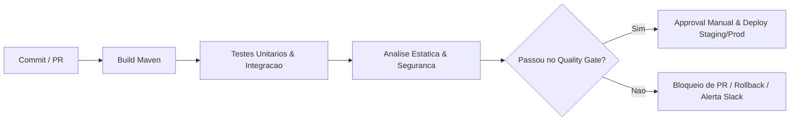
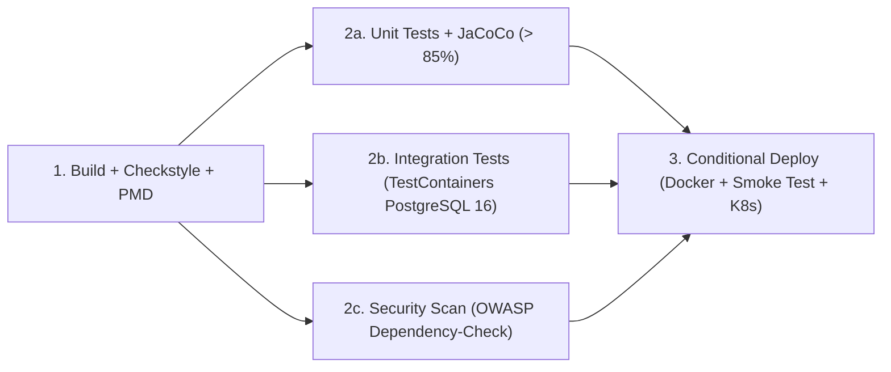

# Aula 10 — Integração Contínua (CI/CD) com Automação de Qualidade

[](https://github.com/RafaelFurgeri/AULA-10/actions/workflows/ci.yml)
[](https://github.com/RafaelFurgeri/AULA-10/actions/workflows/pipeline-completo.yml)

 Implementação prática completa da **Aula 10 de IQS (Integração Contínua / Entrega Contínua com Automação de Qualidade e Segurança)**, contemplando **todas as atividades práticas, exercícios complementares, o Desafio Integrado e a Tarefa Final**.

---

## Sumário das Entregas (Mapeamento do PDF)

| Etapa da Aula | Requisitos Solicitados | Arquivos Implementados |
| :--- | :--- | :--- |
| **Atividade 1: Pipeline CI com GitHub Actions** | Build Maven + JDK 17 + Testes Unitários + Checkstyle + Quality Gate SonarQube + **Relatório JaCoCo** + **Approval Manual antes do Deploy** | `.github/workflows/ci.yml`, `pom.xml`, `config/checkstyle/checkstyle.xml` |
| **Atividade 2: Pipeline CD com Jenkins** | `Jenkinsfile` com Build, Test, Deploy Kubernetes, Notificação Slack + **Estágio de Análise PMD** + **Rollback Automático em falha de Deploy** + Guia Webhook | `Jenkinsfile`, `config/pmd/ruleset.xml`, `Dockerfile`, `k8s/deployment.yaml`, `k8s/service.yaml` |
| **Atividade 3: Automação de Qualidade** | Bloquear PRs com falhas, regras SonarQube (Cobertura >= 80%, Zero bugs críticos, Debt técnico < 1h) + **Simulação de PR com baixa cobertura** | `.github/workflows/quality-gate.yml`, `sonar-project.properties`, branch `simulacao/pr-baixa-cobertura` |
| **Desafio Integrado & Tarefa Final** | Execução **em paralelo** de Testes Unitários e Testes de Integração (**TestContainers + PostgreSQL 16**), Deploy condicional exigindo **todos os testes verdes**, **Cobertura > 85%** e **zero vulnerabilidades no OWASP Dependency-Check** | `.github/workflows/pipeline-completo.yml`, `PostgresOrderRepositoryIT.java`, `pom.xml` |

---

## Arquitetura dos Pipelines

### 1. Pipeline de Qualidade Ideal (Conceitual)



### 2. DAG do Desafio Integrado (`.github/workflows/pipeline-completo.yml`)



---

## Estrutura do Projeto

```text
AULA-10/
├── .github/
│   └── workflows/
│       ├── ci.yml                  # Atividade 1 (+ JaCoCo + Manual Approval + SonarQube)
│       ├── quality-gate.yml        # Atividade 3 (Bloqueio automático de Pull Requests)
│       └── pipeline-completo.yml   # Desafio Integrado & Tarefa Final (Paralelo + TestContainers + OWASP)
├── config/
│   ├── checkstyle/
│   │   └── checkstyle.xml          # Regras de estilo de código (Checkstyle)
│   └── pmd/
│       └── ruleset.xml             # Regras de análise estática e segurança (PMD 7)
├── k8s/
│   ├── deployment.yaml             # Manifesto Kubernetes com RollingUpdate e Health Probes
│   └── service.yaml                # Service Kubernetes para exposição interna da aplicação
├── src/
│   ├── main/java/br/edu/iqs/aula10/
│   │   ├── CustomerTier.java       # Níveis de fidelidade (STANDARD, SILVER, GOLD, PLATINUM)
│   │   ├── DiscountPolicy.java     # Política cumulativa de descontos com teto de 30%
│   │   ├── InMemoryOrderRepository.java
│   │   ├── Order.java              # Entidade de pedido e máquina de estados
│   │   ├── OrderApplication.java   # Microsserviço HTTP com endpoint /health
│   │   ├── OrderItem.java          # Item do pedido com validação de domínio
│   │   ├── OrderRepository.java    # Contrato de persistência
│   │   ├── OrderService.java       # Regras de negócio de processamento, pagamento e cancelamento
│   │   ├── OrderStatus.java        # Estados do pedido (PENDING, PAID, SHIPPED, CANCELLED)
│   │   ├── OrderSummary.java       # Resumo financeiro consolidado
│   │   ├── PostgresOrderRepository.java # Persistência JDBC PostgreSQL real
│   │   └── TaxCalculator.java      # Cálculo de impostos estaduais
│   └── test/java/br/edu/iqs/aula10/
│       ├── *Test.java              # Suíte completa de Testes Unitários JUnit 5 (> 95% cobertura)
│       └── PostgresOrderRepositoryIT.java # Teste de Integração com TestContainers + PostgreSQL 16
├── Dockerfile                      # Build multi-stage (Maven JDK 17 -> Temurin JRE 17 Alpine não-root)
├── Jenkinsfile                     # Pipeline CD declarativo do Jenkins (PMD + Rollback K8s + Slack)
├── pom.xml                         # Configuração Maven completa (JUnit 5, TestContainers, JaCoCo, Checkstyle, PMD, OWASP)
└── sonar-project.properties        # Propriedades e caminhos de relatórios para o SonarQube
```

---

## Detalhamento das Atividades e Exercícios

### Atividade 1 — GitHub Actions, JaCoCo e Approval Manual
1. **Relatório JaCoCo**: O plugin `jacoco-maven-plugin` instrumenta os testes automaticamente, gera relatórios em HTML/XML (`target/site/jacoco/`) publicados via `actions/upload-artifact@v4` e valida a cobertura mínima via `jacoco:check` (`>= 86%`, atendendo à exigência `> 85%`).
2. **Approval Manual antes do Deploy**: Os estágios `deploy-staging` (`ci.yml`) e `deploy` (`pipeline-completo.yml`) utilizam **GitHub Environments** (`environment: staging` e `environment: production`).
   - **Como ativar revisores humanos obrigatórios no GitHub**:
     1. Acesse `Settings` -> `Environments` no repositório GitHub.
     2. Clique em `staging` (ou `production`).
     3. Marque **Required reviewers**, adicione seu usuário e clique em **Save protection rules**.

### Atividade 2 — Jenkins, Webhook, PMD e Rollback Automático
1. **Configuração do Webhook no GitHub**:
   - No repositório GitHub, acesse `Settings` -> `Webhooks` -> `Add webhook`.
   - **Payload URL**: `http://<SEU-SERVIDOR-JENKINS>/github-webhook/`
   - **Content type**: `application/json`
   - **Events**: *Just the push event* (ou *Push and Pull Requests*).
2. **Estágio de Análise PMD**: Adicionado o estágio `Static Analysis (PMD & Checkstyle)` no `Jenkinsfile`, executando `mvn checkstyle:check pmd:pmd pmd:check` e arquivando `target/pmd.xml`.
3. **Rollback Automático em Falha de Deploy**: No estágio `Deploy to Staging` do `Jenkinsfile`, o bloco `post { failure { ... } }` detecta falhas no `kubectl rollout status` e executa automaticamente:
   ```groovy
   sh 'kubectl rollout undo deployment/myapp-deployment'
   sh 'kubectl rollout status deployment/myapp-deployment --timeout=60s'
   ```

### Atividade 3 — Quality Gate, SonarQube e Simulação de PR Rejeitado
1. **Regras no SonarQube (`sonar-project.properties`)**:
   - **Cobertura mínima**: `80%` (elevada para `86%` no `pom.xml` para atender também ao Desafio Integrado `> 85%`).
   - **Zero bugs críticos**: `New Critical Issues = 0`.
   - **Debt técnico**: `< 1h` (`Technical Debt < 60min`).
   - Para integrar a um servidor SonarQube externo/SonarCloud, basta adicionar `SONAR_TOKEN` e `SONAR_HOST_URL` em `Settings -> Secrets and variables -> Actions`.
2. **Bloqueio de PRs no GitHub**:
   - Em `Settings` -> `Branches` -> `Add branch ruleset` (ou *Branch protection rule* para `main`), marque **Require status checks to pass before merging** e selecione os checks `Pull Request Quality Gate`, `Build, Test, Checkstyle & JaCoCo` e `1. Build & Static Analysis`.
3. **Exercício Prático — Simular PR com Baixa Cobertura e Observar a Rejeição**:
   - Foi preparada e enviada ao repositório a branch **`simulacao/pr-baixa-cobertura`**, contendo uma classe grande sem testes unitários (`UncoveredLegacyReportGenerator.java`) que derruba a cobertura global abaixo do limite exigido pelo Quality Gate (`86%`).
   - Para observar o bloqueio na prática, basta abrir um Pull Request dessa branch para a `main`:
     👉 [Abrir Pull Request de Simulação de Baixa Cobertura](https://github.com/RafaelFurgeri/AULA-10/compare/main...simulacao/pr-baixa-cobertura)
   - O workflow `Quality Gate` irá executar automaticamente no PR e **rejeitar o merge** com erro no `jacoco:check`!

### Desafio Integrado & Tarefa Final — TestContainers + OWASP Dependency-Check
- **Execução Paralela**: Após o job `build`, os jobs `unit-tests`, `integration-tests` (subindo um container real `postgres:16-alpine` via **TestContainers**) e `owasp-security-check` rodam simultaneamente.
- **Segurança com OWASP Dependency-Check**:
  - Configurado no `pom.xml` via `org.owasp:dependency-check-maven` (`failBuildOnCVSS = 7.0`, suporte nativo à chave `NVD_API_KEY` nos Secrets do GitHub e cache da base NVD).
  - Caso o secret opcional `NVD_API_KEY` ainda não esteja cadastrado no repositório, o pipeline executa automaticamente uma auditoria de CVEs em tempo real contra a base oficial **OSV/NVD (`api.osv.dev`)** para todas as dependências Maven, garantindo bloqueio imediato de bibliotecas vulneráveis desde o primeiro push.

---

## Comandos para Execução Local

```bash
# Compilar, rodar testes unitários e gerar relatório JaCoCo
mvn clean test jacoco:report jacoco:check

# Validar estilo de código (Checkstyle) e análise estática (PMD)
mvn checkstyle:check pmd:check

# Rodar testes de integração com Docker + TestContainers (PostgreSQL 16)
mvn verify -Pintegration-tests

# Executar varredura de vulnerabilidades OWASP Dependency-Check
mvn dependency-check:check
```

---

## Discussão de Encerramento: GitHub Actions vs Jenkins

| Critério | GitHub Actions | Jenkins |
| :--- | :--- | :--- |
| **Hospedagem e Infraestrutura** | SaaS gerenciado (runners Ubuntu/Windows/macOS prontos com Docker pré-instalado), zero custo operacional de servidor para repositórios públicos. | Exige provisionamento, atualização, segurança e manutenção de servidores/clusters próprios e agentes de build. |
| **Configuração e Curva de Aprendizado** | Arquivos YAML declarativos em `.github/workflows/`, nativamente integrados a Pull Requests, Environments e GitHub Marketplace. | `Jenkinsfile` em Groovy (Declarative ou Scripted Pipeline), extremamente flexível, porém exige administração de plugins. |
| **Ecossistema e Customização** | Excelente para projetos hospedados no GitHub, microsserviços modernos e nuvem. | Ideal para ambientes corporativos *on-premises*, redes isoladas, integrações legadas heterogêneas e controle total de hardware. |

**Conclusão para o nosso projeto:** Para este projeto Java moderno hospedado no GitHub (utilizando Maven, JUnit 5, TestContainers em Docker, Checkstyle, PMD, JaCoCo e OWASP), o **GitHub Actions é a abordagem mais indicada**, pois elimina a necessidade de manter infraestrutura dedicada, já oferece Docker nativo nos runners `ubuntu-latest` para o TestContainers, integra bloqueio de PRs e *Manual Approvals* diretamente na interface do repositório e acelera o ciclo de feedback da equipe. O `Jenkinsfile` permanece no projeto garantindo portabilidade caso a aplicação precise rodar em infraestrutura corporativa híbrida/*on-premises*.
